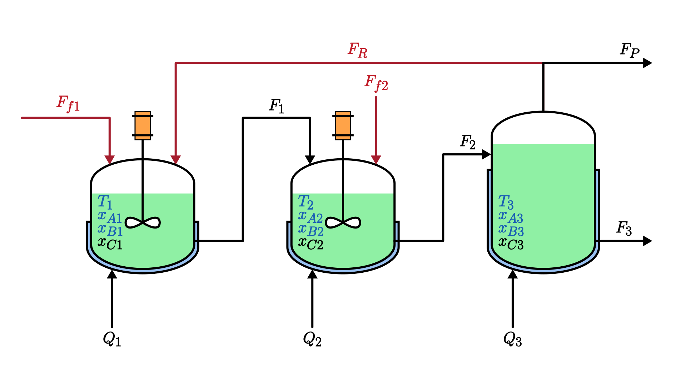

# Análise de um Sistema de Dois Reatores e um Separador com Reciclo

Trabalho de Silas Henrique Alves Araújo para a disciplina **ENGF95 – Análise de Processos e Sistemas II**, do curso de Engenharia de Controle e Automação de Processos da Escola Politécnica da UFBA.

Este repositório caracteriza a dinâmica de um processo com dois reatores contínuos de tanque agitado (CSTRs) e um separador, ligados por uma corrente de reciclo, utilizando as ferramentas clássicas de análise de sistemas lineares.

## O sistema

O processo é baseado em Pourkargar, Almansoori e Daoutidis (2017). Nele ocorrem duas reações exotérmicas consecutivas, $A \rightarrow B \rightarrow C$, em que $B$ é o produto de interesse e $C$ é um subproduto. Uma corrente de reciclo retorna do separador ao primeiro reator, e uma corrente de purga evita o acúmulo de subprodutos.

## 📂 Estrutura do repositório

- `pyproject.toml` → dependências e configuração do projeto, gerenciado com [uv](https://docs.astral.sh/uv/)
- `src/` → notebooks em Python que explicam e resolvem cada etapa da análise
  - `src/lib/` → funções auxiliares reutilizadas pelos notebooks

## Referência

- Pourkargar, D. B., Almansoori, A., & Daoutidis, P. (2017). Distributed model predictive control of process networks: Impact of control architecture. _IFAC-PapersOnLine_, 50(1), 12452–12457. [https://doi.org/10.1016/j.ifacol.2017.08.1920](https://doi.org/10.1016/j.ifacol.2017.08.1920)
